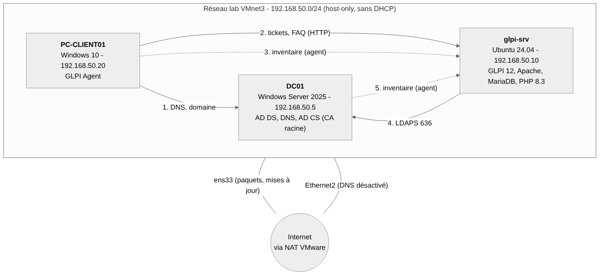

# Plateforme ITSM de support et de gestion de parc (GLPI) pour une PME

Déploiement d'une plateforme **GLPI 12** de gestion de tickets et d'inventaire pour **Atelier Morel**, une PME fictive de
30 utilisateurs, dans un laboratoire **VMware**. L'infrastructure est celle d'une petite entreprise : annuaire Active Directory,
DNS interne, autorité de certification, postes Windows inventoriés automatiquement.

> Projet personnel de laboratoire. Les données (entreprise, personnes) sont fictives.

## Ce que le projet démontre

| Compétence | Où le voir |
|---|---|
| Installer et sécuriser un serveur Linux applicatif (Apache, MariaDB, PHP) | [docs/installation-sauvegarde.md](docs/installation-sauvegarde.md) |
| Sauvegarder et **restaurer** une application | [docs/installation-sauvegarde.md](docs/installation-sauvegarde.md) |
| Active Directory, DNS, autorité de certification, LDAPS | [docs/ad-dns.md](docs/ad-dns.md) |
| Organiser un support : entités, profils, SLA, règles automatiques, FAQ | [docs/glpi-organisation.md](docs/glpi-organisation.md) |
| Inventaire automatique du parc (GLPI Agent), moindre privilège | [docs/inventaire-agent.md](docs/inventaire-agent.md) |
| Diagnostiquer et documenter des incidents | [incidents/](incidents/) |
| Automatiser avec PowerShell | [scripts/](scripts/) |

## Architecture



| Machine | Système | Adresse | Rôle |
|---|---|---|---|
| `DC01` | Windows Server 2025 | 192.168.50.5 | Active Directory, DNS, autorité de certification |
| `glpi-srv` | Ubuntu 24.04 | 192.168.50.10 | GLPI 12 (Apache, MariaDB, PHP 8.3) |
| `PC-CLIENT01` | Windows 10 | 192.168.50.20 | Poste client du domaine, GLPI Agent |

Réseau de laboratoire isolé (VMnet3, host-only, 192.168.50.0/24, sans DHCP). Une carte NAT sur les serveurs ne sert qu'aux mises à jour.
Domaine `atelier.local`, interface GLPI sur `glpi.atelier.local`.

## Réalisé

- [x] GLPI 12 installé sur Ubuntu 24.04, comptes par défaut sécurisés, tâche planifiée GLPI
- [x] Script de sauvegarde (base + fichiers, rotation 7 jours) et **test de restauration**
- [x] Entité, profils, groupes de support N1/N2, catégories, calendrier, **SLA** (4 h / 1 jour / 3 jours), règles métier
- [x] Base de connaissances (FAQ visible des employés)
- [x] Active Directory (OU, 30 utilisateurs créés par script, groupes), DNS, autorité de certification, LDAPS
- [x] Poste client joint au domaine, **authentification des employés sur GLPI avec leur compte de domaine**
- [x] **Inventaire automatique** avec GLPI Agent, routage vers la bonne entité par règle sur un tag
- [x] 5 fiches d'incident documentées
- [ ] Tableau de bord (tickets ouverts, délai moyen de résolution, tickets hors SLA) : en cours
- [ ] Déploiement de l'agent par GPO, HTTPS, 2FA : pistes d'amélioration

## Incidents résolus

| Fiche | Incident | Cause racine |
|---|---|---|
| [INC-01](incidents/INC-01-ldap-bind-refuse.md) | Liaison LDAP refusée (« Strong(er) authentication required ») | Le contrôleur de domaine refuse le LDAP en clair : passage en LDAPS avec une autorité interne |
| [INC-02](incidents/INC-02-dns-resolution.md) | Résolution DNS erratique | Contrôleur de domaine à deux cartes qui enregistre l'adresse NAT dans le DNS |
| [INC-03](incidents/INC-03-kb-invisible-self-service.md) | FAQ vide pour les employés | Articles non autorisés sur l'entité et non marqués FAQ |
| [INC-04](incidents/INC-04-poste-mauvaise-entite.md) | Poste inventorié dans l'entité racine | Aucune règle d'affectation : règle sur le tag de l'agent |
| [INC-05](incidents/INC-05-inventaire-partiel.md) | Fiche d'ordinateur incomplète | Inventaire partiel de l'agent après suppression de la fiche : `--full` |

## Captures

Voir [captures/](captures/) : inventaire des postes, tickets, SLA, règles, annuaire LDAP, tableau de bord.

## Structure du dépôt

```
architecture/   schéma (Mermaid, PNG, SVG)
docs/           installation et sauvegarde, AD et DNS, organisation GLPI, inventaire
scripts/        création des utilisateurs AD (PowerShell), sauvegarde GLPI, exemples de configuration
incidents/      fiches de résolution
captures/       copies d'écran numérotées
dashboard/      export du tableau de bord
```

## Sécurité

- Aucun mot de passe, clé ni fichier de configuration sensible dans ce dépôt (`config_db.php` et `glpicrypt.key` volontairement exclus).
- Mots de passe saisis à l'invite (`Read-Host -AsSecureString`, `-W` pour `ldapsearch`), générés avec `openssl rand -base64 18` et stockés dans un gestionnaire.
- Comptes de service à moindre privilège : `svc-glpi-ldap` (lecture de l'annuaire) et `svc-agent-glpi` (envoi d'inventaire uniquement).

## Limites et améliorations possibles

- Authentification des agents en mode basique : OAuth serait préférable en production.
- GLPI en HTTP dans le lab : ajouter HTTPS (certificat émis par l'autorité interne).
- Déploiement de l'agent à la main sur 2 machines : passer par une GPO pour un vrai parc.
- Rattachement automatique poste/utilisateur : un seul utilisateur retenu sur un poste partagé.
- Pas de sauvegarde hors machine : copier les sauvegardes vers un autre support.
