# Active Directory, DNS et autorité de certification

Toutes les commandes sont exécutées dans un **PowerShell ouvert en administrateur** sur DC01.
Chaque option est expliquée : le but de ce dépôt est aussi de montrer qu'on comprend ce qu'on tape.

## 1. Plan réseau de DC01

| Carte | Rôle | Adresse |
|---|---|---|
| Ethernet1 | Réseau lab (VMnet3) | 192.168.50.5/24, sans passerelle |
| Ethernet2 | NAT (internet) | DHCP VMware, **enregistrement DNS désactivé** |

DC01 est **multi-homed** : sans précaution, la carte NAT enregistre son adresse dans la zone DNS du domaine
(voir [INC-02](../incidents/INC-02-dns-resolution.md)).

## 2. Structure Active Directory

Forêt `atelier.local` (NetBIOS `ATELIER`), DNS intégré à l'AD.

```
atelier.local
└── Atelier Morel
    ├── Utilisateurs
    │   └── Direction / Administratif / Commercial / Production / Informatique
    ├── Groupes        (GG_Direction, GG_Administratif, GG_Commercial, GG_Production, GG_Informatique)
    ├── Ordinateurs    (PC-CLIENT01)
    └── Serveurs       (compte de service svc-glpi-ldap)
```

Création des OU et groupes (principe). Les OU `Atelier Morel`, `Utilisateurs`, `Groupes`, `Ordinateurs` et `Serveurs` sont créées d'abord
avec `New-ADOrganizationalUnit`, puis les cinq OU de services et les groupes :

```powershell
$services = "Direction","Administratif","Commercial","Production","Informatique"
foreach ($s in $services) {
    New-ADOrganizationalUnit -Name $s -Path "OU=Utilisateurs,OU=Atelier Morel,DC=atelier,DC=local"
    New-ADGroup -Name "GG_$s" -GroupScope Global -GroupCategory Security `
                -Path "OU=Groupes,OU=Atelier Morel,DC=atelier,DC=local"
}
```

- `New-ADOrganizationalUnit -Name -Path` : crée une unité d'organisation (le conteneur qui reçoit les objets et les GPO). Attention à l'orthographe **Organizational** avec un « z ».
- `New-ADGroup -GroupScope Global` : groupe de portée globale, standard pour regrouper des utilisateurs d'un même domaine.
- `-GroupCategory Security` : groupe de **sécurité** (utilisable pour des droits), par opposition à un groupe de distribution.
- `foreach ($s in $services) { ... }` : répète le bloc pour chaque service, sans copier-coller.

Les 30 utilisateurs sont créés par [`scripts/New-AtelierUsers.ps1`](../scripts/New-AtelierUsers.ps1) à partir de `utilisateurs.csv`.
Le mot de passe initial est saisi à l'invite avec `Read-Host -AsSecureString` (le tiret est indispensable : un oubli l'affiche en clair).
`-ChangePasswordAtLogon $true` force le changement à la première connexion.

Contrôle du nombre d'utilisateurs par service :

```powershell
Get-ADUser -Filter * -SearchBase "OU=Utilisateurs,OU=Atelier Morel,DC=atelier,DC=local" -Properties Department |
  Group-Object Department | Select-Object Name, Count
```

- `-SearchBase` : limite la recherche à cette OU.
- `-Properties Department` : charge l'attribut (non retourné par défaut).
- `Group-Object` : regroupe et compte, `Select-Object` garde les deux colonnes utiles.

## 3. Compte de service pour GLPI (moindre privilège)

Compte `svc-glpi-ldap` : membre uniquement de « Utilisateurs du domaine », **aucun droit d'administration**.
Il lit l'annuaire, rien d'autre.

```powershell
New-ADUser -Name "svc-glpi-ldap" -SamAccountName "svc-glpi-ldap" `
           -UserPrincipalName "svc-glpi-ldap@atelier.local" `
           -Path "OU=Serveurs,OU=Atelier Morel,DC=atelier,DC=local" `
           -AccountPassword (Read-Host -AsSecureString "Mot de passe") `
           -PasswordNeverExpires $true -CannotChangePassword $true -Enabled $true
```

- `-PasswordNeverExpires $true` : un compte de service ne doit pas expirer sans prévenir (sinon la synchro GLPI casse un matin).
- `-CannotChangePassword $true` : personne ne peut le modifier hors procédure.
- Le mot de passe est généré avec `openssl rand -base64 18` et rangé dans un gestionnaire de mots de passe.

## 4. DNS

```powershell
Add-DnsServerResourceRecordA -ZoneName atelier.local -Name glpi -IPv4Address 192.168.50.10
Set-DnsClient -InterfaceAlias "Ethernet2" -RegisterThisConnectionsAddress $false
dnscmd /ResetListenAddresses 192.168.50.5
Resolve-DnsName glpi.atelier.local -DnsOnly -Server 192.168.50.5
```

- `Add-DnsServerResourceRecordA` : crée l'enregistrement `glpi.atelier.local` vers le serveur GLPI.
- `Set-DnsClient ... -RegisterThisConnectionsAddress $false` : la carte NAT n'inscrit plus son IP dans le DNS.
- `dnscmd /ResetListenAddresses <ip>` : le service DNS n'écoute que sur l'IP du lab.
- `Resolve-DnsName -DnsOnly -Server` : interroge **ce serveur DNS précisément**, sans passer par le cache ni le fichier hosts.

Sur glpi-srv, le DNS du lab est déclaré dans `/etc/netplan/` (`nameservers: addresses: [192.168.50.5]`, `search: [atelier.local]`), puis :

```bash
sudo netplan try
resolvectl status ens34
```

- `netplan try` : applique la configuration et **la retire automatiquement au bout de 120 s si on ne confirme pas**. C'est le garde-fou contre une coupure réseau en SSH.

## 5. Jonction du poste client au domaine

PC-CLIENT01 : DNS = 192.168.50.5, jonction dans l'OU `Ordinateurs` :

```powershell
Add-Computer -DomainName atelier.local -OUPath "OU=Ordinateurs,OU=Atelier Morel,DC=atelier,DC=local" -Credential ATELIER\<admin> -Restart
```

- `-OUPath` : range directement l'ordinateur dans la bonne OU (sinon il atterrit dans le conteneur `Computers` par défaut).
- `-Restart` : redémarre pour finaliser la jonction.

## 6. Autorité de certification et LDAPS

Pourquoi : Windows Server 2025 refuse les liaisons LDAP simples en clair (signature LDAP exigée, voir [INC-01](../incidents/INC-01-ldap-bind-refuse.md)).

1. Installer le rôle **AD CS** en autorité racine d'entreprise : `Atelier-Morel-CA`. Le contrôleur de domaine reçoit un certificat et écoute en **LDAPS (636)**.
2. Exporter le certificat de l'autorité et le déployer sur glpi-srv :

```powershell
$ca = Get-ChildItem Cert:\LocalMachine\Root | Where-Object {$_.Subject -like "*Atelier-Morel-CA*"} |
      Sort-Object NotBefore -Descending | Select-Object -First 1
Export-Certificate -Cert $ca -FilePath C:\Scripts\atelier-ca.crt -Type CERT
certutil -encode C:\Scripts\atelier-ca.crt C:\Scripts\atelier-ca.pem
```

- `Get-ChildItem Cert:\LocalMachine\Root` : liste les autorités racines de confiance de la machine.
- `Sort-Object NotBefore -Descending | Select-Object -First 1` : si plusieurs certificats portent ce nom (renouvellements), garde le plus récent.
- `Export-Certificate -Type CERT` : exporte la partie publique uniquement (jamais la clé privée).
- `certutil -encode` : convertit en texte PEM, le format attendu côté Linux.

```bash
sudo cp atelier-ca.crt /usr/local/share/ca-certificates/atelier-ca.crt
sudo update-ca-certificates
openssl s_client -connect dc01.atelier.local:636 -CAfile /usr/local/share/ca-certificates/atelier-ca.crt </dev/null
```

Attendu : `Verify return code: 0 (ok)`. Note : le fichier copié dans `ca-certificates` doit se terminer par `.crt` et être au format PEM.

## Captures

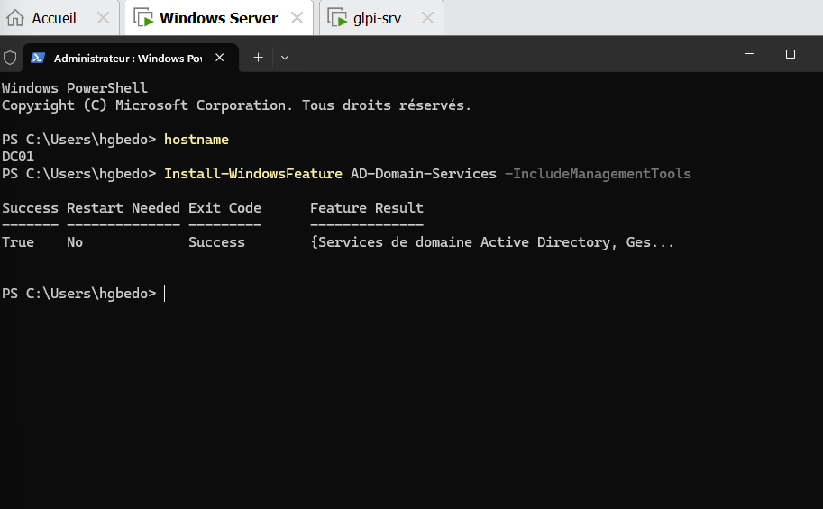
*Installation du rôle AD DS*

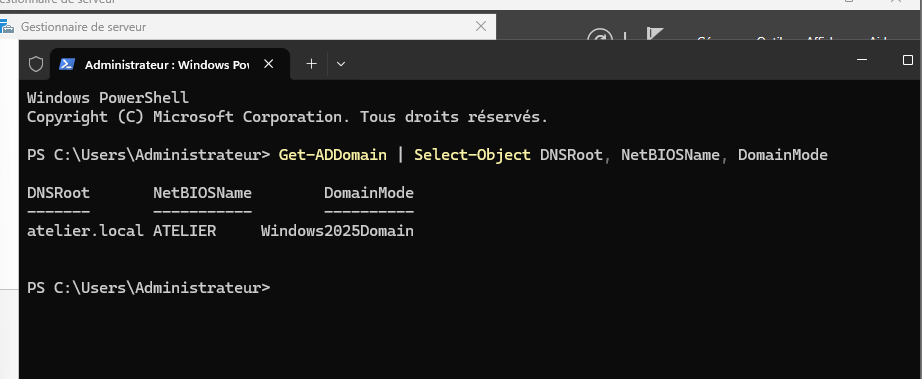
*Domaine atelier.local créé*

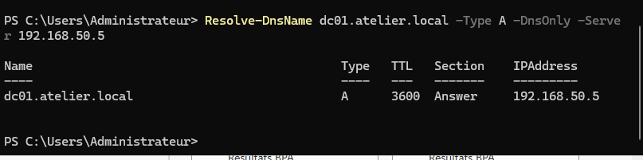
*Résolution DNS de DC01*

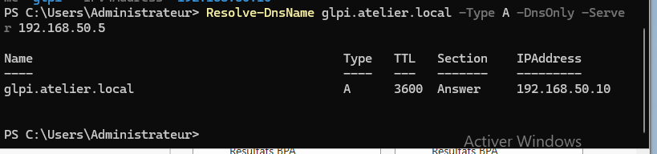
*Enregistrement DNS de glpi.atelier.local*

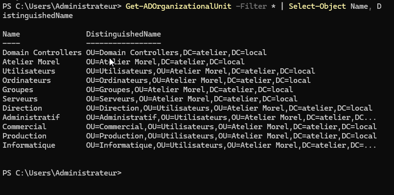
*Structure des unités d'organisation*

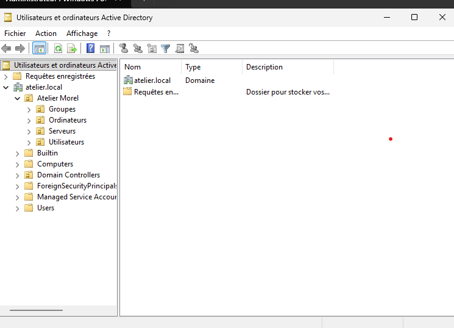
*Console Utilisateurs et ordinateurs Active Directory*

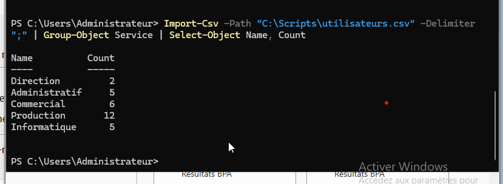
*Fichier CSV des utilisateurs*

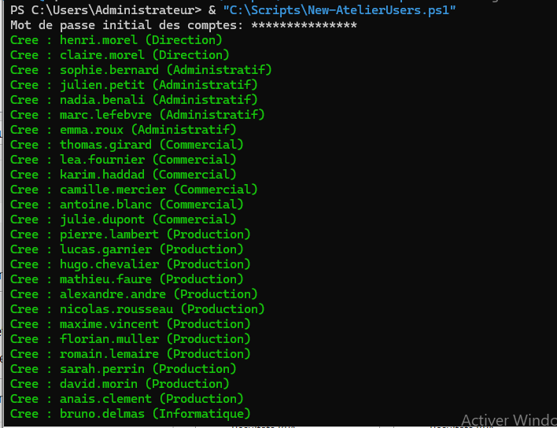
*Exécution du script de création des comptes*

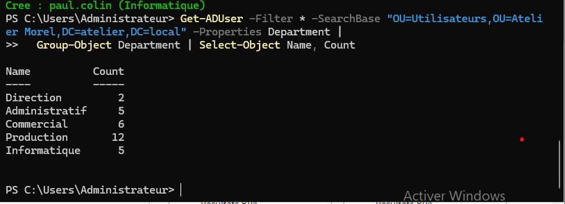
*Vérification des comptes créés par service*

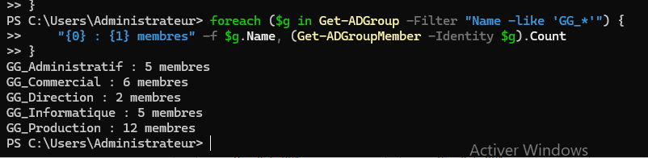
*Groupes de sécurité et nombre de membres*

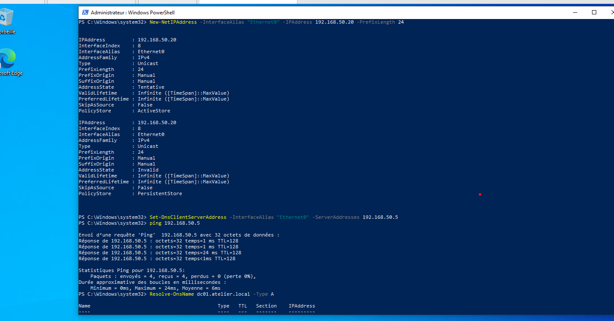
*Configuration IP et DNS du poste client*

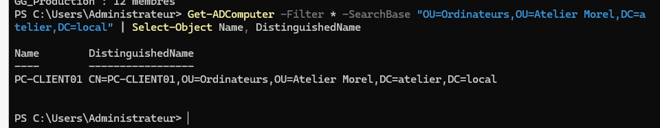
*Poste client dans l'OU Ordinateurs*

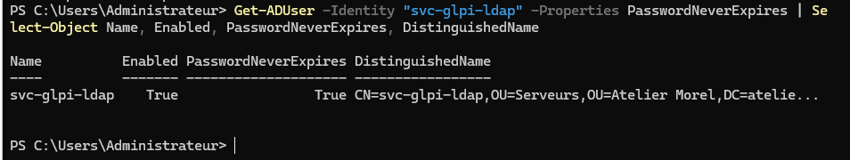
*Compte de service svc-glpi-ldap (mot de passe sans expiration)*

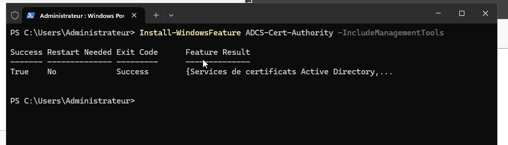
*Installation d'AD CS*

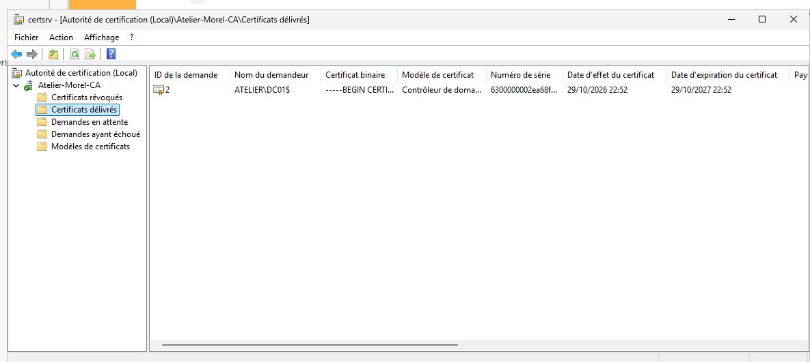
*Certificat du contrôleur de domaine pour LDAPS*

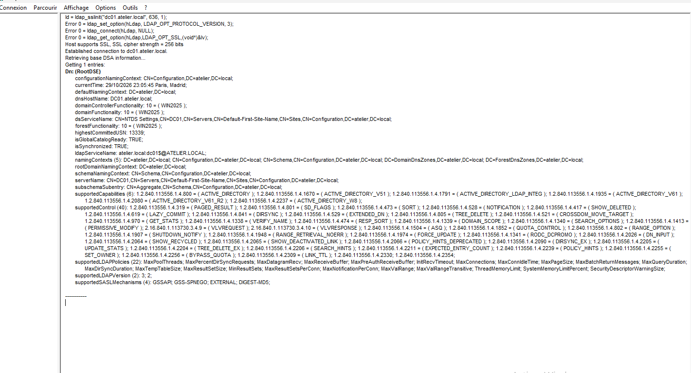
*Connexion LDAPS testée avec ldp.exe*

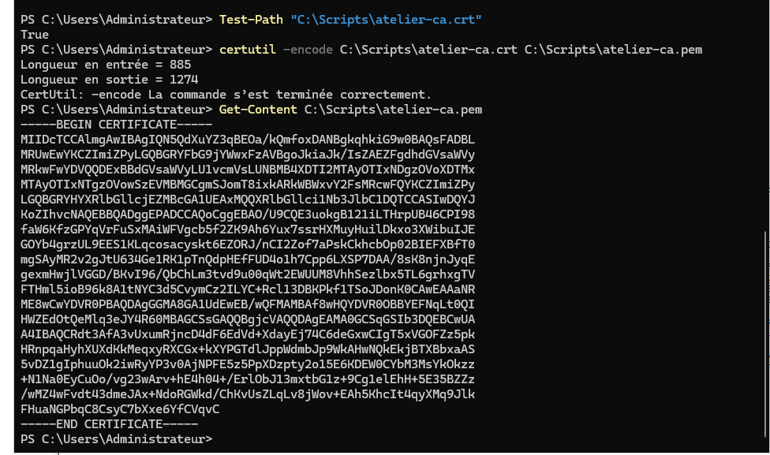
*Export du certificat de l'autorité*

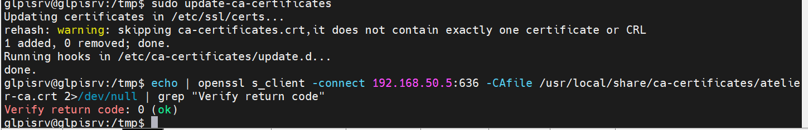
*Autorité approuvée sur glpi-srv*
