# Organisation du service dans GLPI

Cette page décrit comment GLPI a été configuré pour reproduire le fonctionnement d'un support informatique de PME.

## Entités et lieux

- Entité racine puis **Atelier Morel** (client de l'exercice, 30 utilisateurs).
- Lieux rattachés : **Siège**, **Atelier**, **Salle serveur**.
- Les postes et serveurs sont rattachés à un lieu et à un utilisateur (voir [inventaire](inventaire-agent.md)).

## Profils et habilitations

Profils standard de GLPI utilisés : Self-Service (employés), Technician, Supervisor, Super-Admin.
Un profil dédié **Agent inventaire** (interface standard) ne porte que le droit d'envoi d'inventaire : c'est le
profil du compte de service `svc-agent-glpi`. Principe : **chaque compte n'a que ce dont il a besoin**.

Les employés importés de l'AD reçoivent automatiquement le profil Self-Service sur l'entité Atelier Morel
grâce à une règle d'affectation d'habilitations (`Employés AD → Self-Service Atelier Morel`, récursif Non).

## Calendrier, SLA et priorités

- Calendrier **Heures ouvrées Atelier Morel** : lundi au vendredi, 08:30-12:30 et 13:30-17:30.
- Niveau de service (SLM) **Support Atelier Morel** lié à ce calendrier, avec trois SLA sur le temps de résolution (TTR) :

| SLA | Délai de résolution |
|---|---|
| SLA Critique | 4 heures |
| SLA Standard | 1 jour |
| SLA Faible | 3 jours |

- Matrice **urgence × impact → priorité** de GLPI conservée par défaut (Configuration > Générale > Assistance).

## Règles métier sur les tickets

Elles s'appliquent à la création du ticket, sans intervention humaine :

| Règle | Condition | Action |
|---|---|---|
| SLA Critique selon priorité | Priorité Très haute **ou** Haute | SLA de résolution = SLA Critique |
| SLA Standard selon priorité | Priorité Moyenne | SLA de résolution = SLA Standard |
| SLA Faible selon priorité | Priorité Basse **ou** Très basse | SLA de résolution = SLA Faible |
| Catégorie Réseau vers Support N2 | Catégorie = Réseau | Groupe de techniciens = Support N2 |

## Base de connaissances

Trois articles d'aide publiés, autorisés sur l'entité Atelier Morel et **marqués FAQ** pour être visibles des
employés dans l'interface Self-Service (voir [INC-03](../incidents/INC-03-kb-invisible-self-service.md)).

## Annuaire LDAP

- Annuaire « Active Directory atelier.local » : LDAPS (636), compte `svc-glpi-ldap` (lecture seule).
- Base de recherche : OU `Utilisateurs` de l'entreprise. Import via Administration > Utilisateurs > Liaison annuaire LDAP.
- 30 utilisateurs importés. Les employés se connectent à GLPI avec leur compte de domaine.

## Règle à garder en tête : la règle « Root »

GLPI fournit une règle d'affectation d'habilitations par défaut qui donne le profil Self-Service sur l'**entité racine**.
Un employé pourrait ainsi créer des tickets hors de l'entité Atelier Morel, donc sans SLA ni routage. Elle a été désactivée.

## Captures

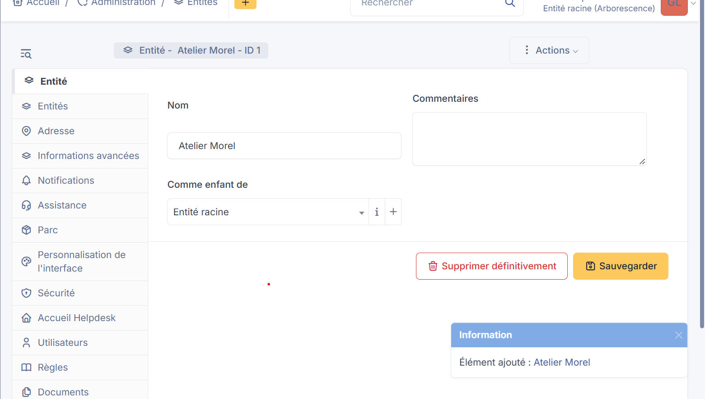
*Entité Atelier Morel*

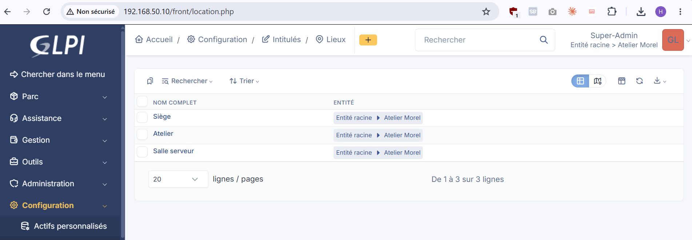
*Lieux : Siège, Atelier, Salle serveur*

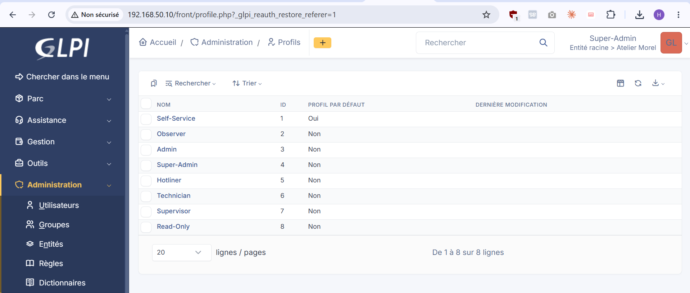
*Profils*

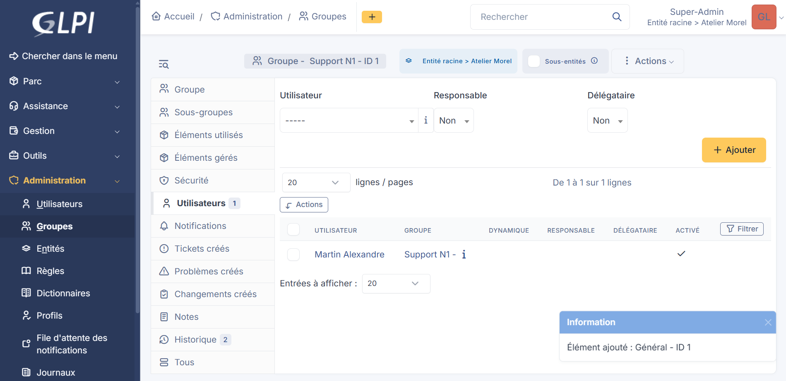
*Groupe de support et ses membres*

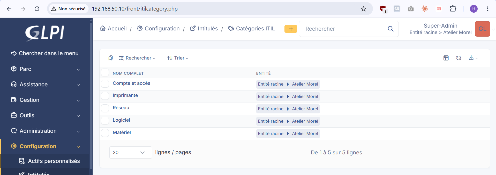
*Catégories de tickets*

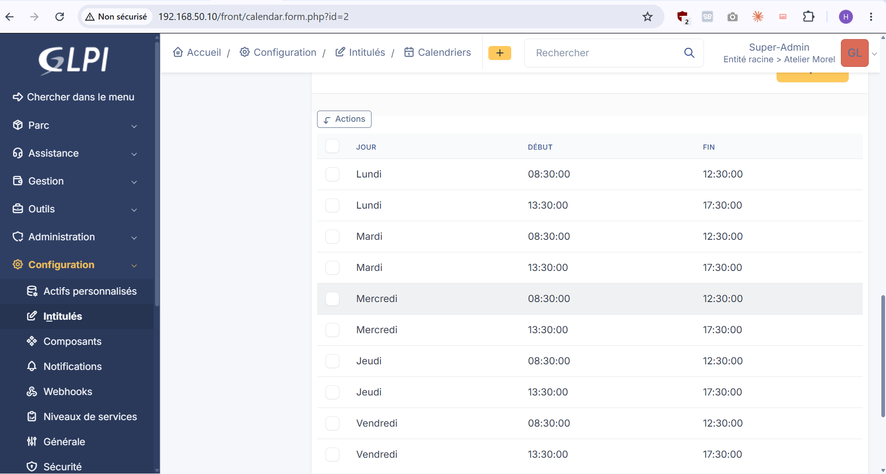
*Calendrier des heures ouvrées*

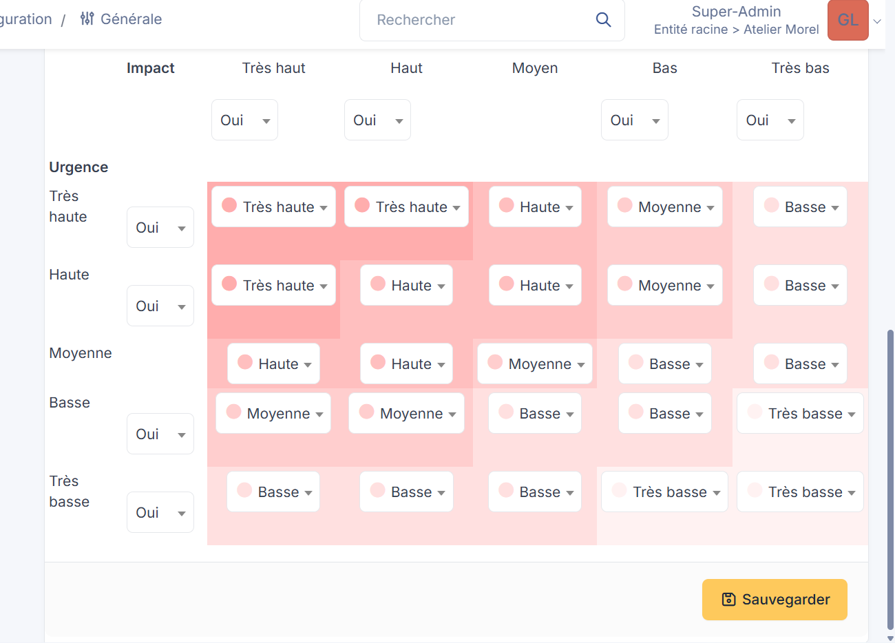
*Matrice urgence × impact*

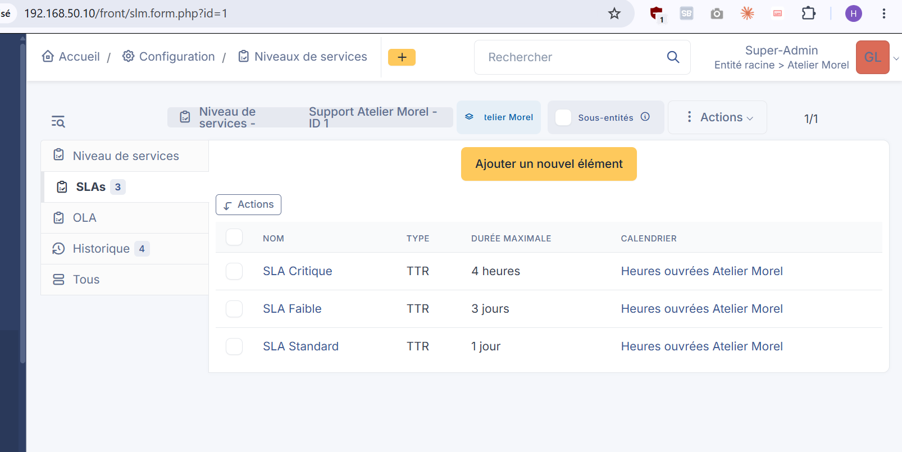
*Niveau de service et les 3 SLA (4 h, 1 jour, 3 jours)*

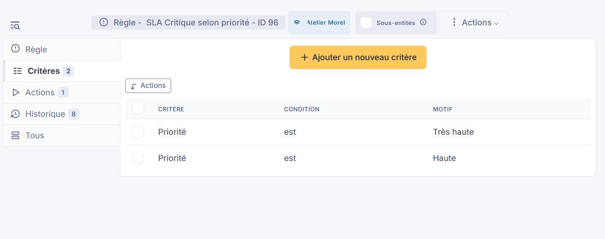
*Règle SLA Critique : critères*

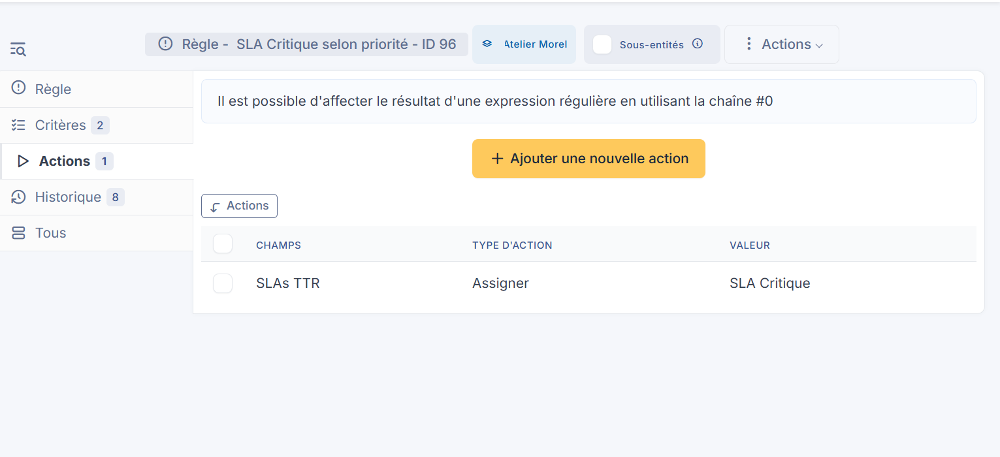
*Règle SLA Critique : actions*

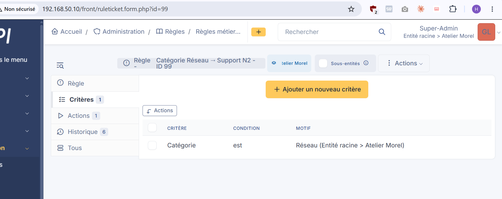
*Règle Catégorie Réseau vers Support N2*

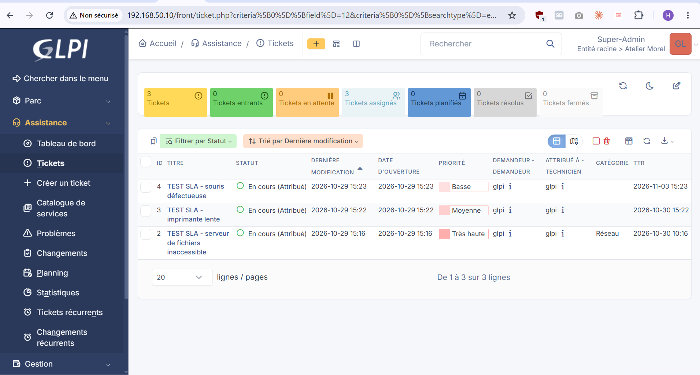
*Tickets de test avec SLA appliqué selon la priorité*

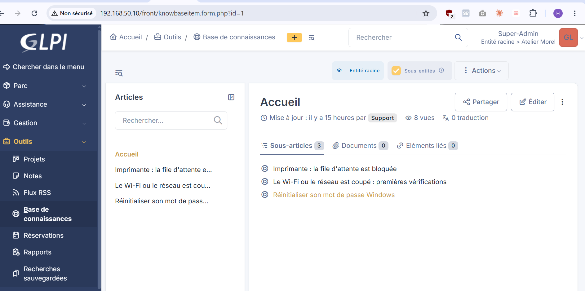
*Base de connaissances*

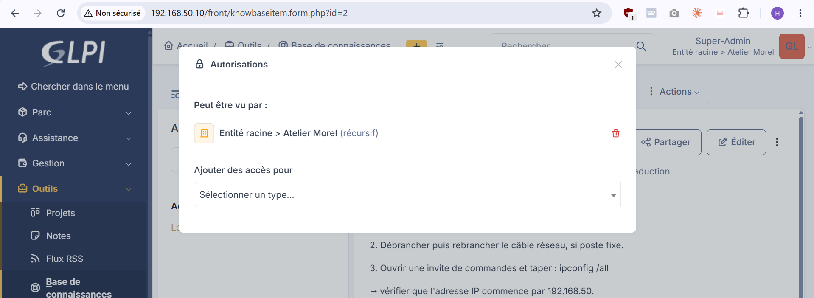
*Autorisations d'un article*

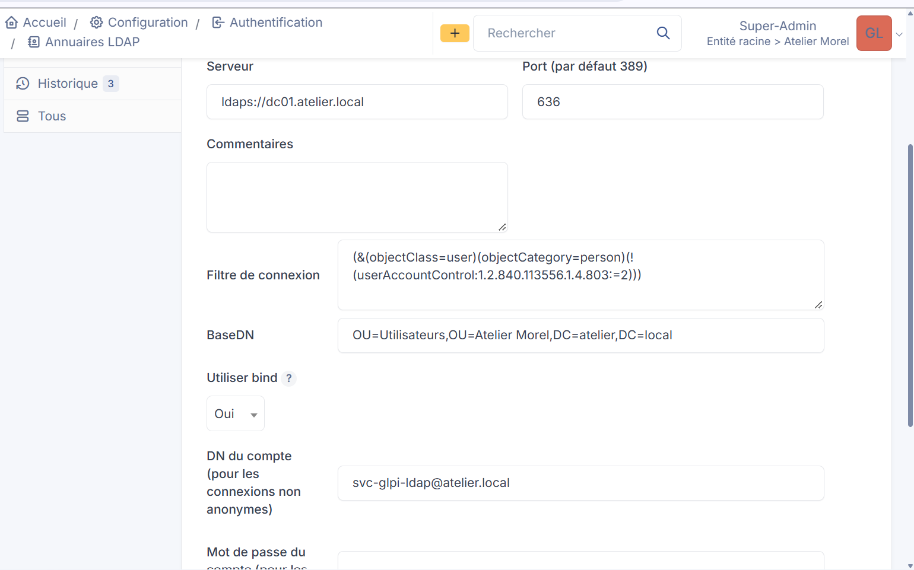
*Annuaire LDAP : paramètres*

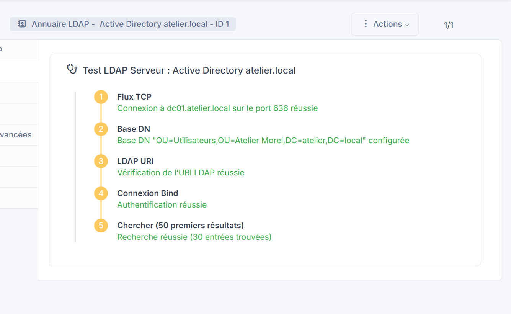
*Test LDAP réussi (30 entrées)*

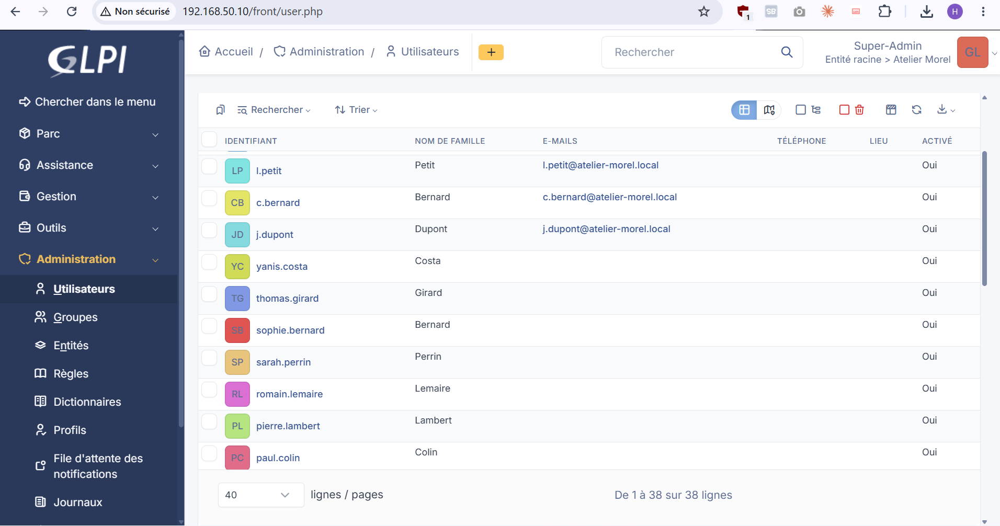
*Utilisateurs importés de l'AD*

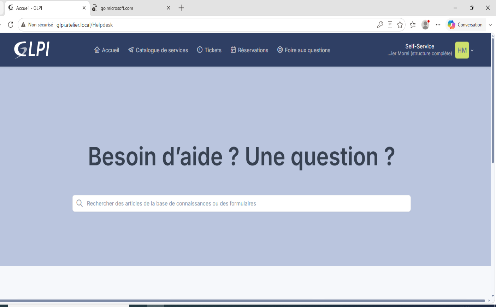
*Connexion d'un employé avec son compte de domaine*

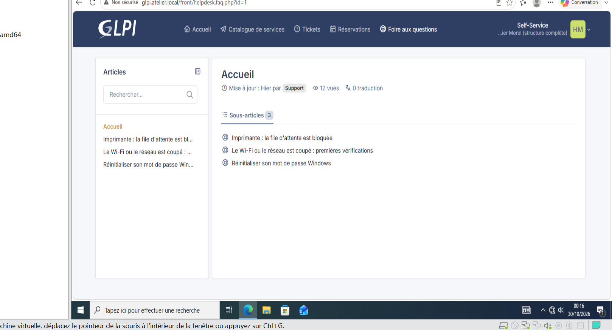
*FAQ vue par un employé*
