# Installation, sauvegarde et restauration de GLPI

Serveur `glpi-srv` : Ubuntu 24.04, GLPI 12.0.1, Apache, MariaDB, PHP 8.3.

## 1. Choix d'architecture : séparer code, configuration et données

GLPI peut tout mettre dans un seul dossier. Ici, l'arborescence est séparée (recommandation de l'éditeur pour la production),
ce qui simplifie les sauvegardes et la sécurité :

| Dossier | Contenu | Sauvegardé |
|---|---|---|
| `/var/www/glpi` | code de l'application (remplaçable à chaque mise à jour) | non, se retélécharge |
| `/etc/glpi` | configuration : accès à la base, clé de chiffrement | **oui** |
| `/var/lib/glpi` | données : documents, inventaires, fichiers téléversés | **oui** |
| `/var/log/glpi` | journaux de l'application | non |

Seul `public/` est exposé par Apache : le reste du code n'est pas accessible depuis le web.

## 2. Réseau

Deux cartes : `ens33` en NAT (DHCP, accès internet pour les paquets) et `ens34` sur le réseau du lab
(192.168.50.10/24, sans passerelle, DNS = DC01). Fichier : [`netplan-glpi-srv.yaml`](../scripts/config-exemples/netplan-glpi-srv.yaml).

```bash
sudo netplan try
```

`netplan try` applique la configuration puis **l'annule seul après 120 s** si on ne confirme pas : indispensable à distance.

## 3. Installation de la pile

```bash
sudo apt update && sudo apt install -y apache2 mariadb-server php8.3 libapache2-mod-php8.3 \
  php8.3-mysql php8.3-curl php8.3-gd php8.3-intl php8.3-mbstring php8.3-xml php8.3-zip \
  php8.3-bz2 php8.3-ldap php8.3-opcache
sudo mysql_secure_installation
```

- `apt install -y` : installe sans demander de confirmation.
- Les modules PHP correspondent aux prérequis vérifiés par l'installeur de GLPI (base, XML, images, internationalisation, LDAP, etc.).
- `mysql_secure_installation` : durcit MariaDB (supprime les comptes anonymes et la base de test, désactive la connexion root distante).

Base et compte applicatif dédiés (le mot de passe est généré par `openssl rand -base64 18` et rangé dans un gestionnaire, jamais écrit dans une commande ni dans ce dépôt) :

```sql
CREATE DATABASE glpi CHARACTER SET utf8mb4 COLLATE utf8mb4_unicode_ci;
CREATE USER 'glpi'@'localhost' IDENTIFIED BY '<mot de passe généré>';
GRANT ALL PRIVILEGES ON glpi.* TO 'glpi'@'localhost';
FLUSH PRIVILEGES;
```

- `utf8mb4` : encodage complet (accents, émojis), requis par GLPI.
- Le compte `glpi` n'a de droits que sur la base `glpi`, et uniquement depuis `localhost`.

## 4. Déploiement de GLPI

1. Télécharger l'archive officielle de GLPI 12.0.1, la décompresser dans `/var/www/glpi`.
2. Créer `/etc/glpi`, `/var/lib/glpi`, `/var/log/glpi` et y déplacer ce qui doit être séparé.
3. Indiquer à GLPI où chercher sa configuration : [`downstream.php`](../scripts/config-exemples/downstream.php) dans `/var/www/glpi/inc/`
   et [`local_define.php`](../scripts/config-exemples/local_define.php) dans `/etc/glpi/` (chemins des données et des journaux).
4. Droits : `www-data` (le compte d'Apache) doit pouvoir écrire dans `/etc/glpi`, `/var/lib/glpi`, `/var/log/glpi` :

```bash
sudo chown -R www-data:www-data /etc/glpi /var/lib/glpi /var/log/glpi
sudo chown -R root:root /var/www/glpi
```

## 5. Apache et PHP

- Hôte virtuel : [`glpi-apache.conf`](../scripts/config-exemples/glpi-apache.conf) (racine sur `public/`, réécriture vers le routeur de GLPI,
  transmission de l'en-tête `Authorization`, journaux dédiés).
- Réglages PHP : [`php-glpi.ini`](../scripts/config-exemples/php-glpi.ini) (téléversement 20 Mo, mémoire 256 Mo, cookies de session `HttpOnly`, fuseau Europe/Paris).

```bash
sudo a2enmod rewrite
sudo a2dissite 000-default
sudo a2ensite glpi
sudo apache2ctl configtest
sudo systemctl reload apache2
```

- `a2enmod rewrite` : active la réécriture d'URL, nécessaire au routeur de GLPI.
- `a2dissite` / `a2ensite` : désactive la page par défaut, active le site GLPI.
- `apache2ctl configtest` : vérifie la syntaxe **avant** de recharger (attendu : `Syntax OK`).
- `reload` plutôt que `restart` : prend en compte la configuration sans couper les connexions en cours.

## 6. Installation par l'assistant web

`http://glpi.atelier.local` (ou l'adresse IP) : langue, vérification des prérequis, connexion à la base (compte `glpi`),
création du schéma. Les données de démonstration ont été **désactivées**.

## 7. Durcissement après installation

- Mots de passe des comptes par défaut changés, **trois comptes inutiles désactivés** (le bandeau d'avertissement de sécurité disparaît).
- Fichiers de configuration lisibles uniquement par `www-data` (`config_db.php` et `glpicrypt.key` ne sont jamais copiés ni versionnés).
- Tâche planifiée GLPI (SLA, relances, notifications, inventaires) : [`cron-glpi`](../scripts/config-exemples/cron-glpi),
  déposée dans `/etc/cron.d/`, exécutée chaque minute par `www-data`.

## 8. Sauvegarde

Script : [`glpi-backup.sh`](../scripts/glpi-backup.sh), installé dans `/usr/local/sbin/`.

```bash
sudo install -m 750 glpi-backup.sh /usr/local/sbin/glpi-backup.sh
sudo /usr/local/sbin/glpi-backup.sh
```

| Élément | Explication |
|---|---|
| `set -euo pipefail` | le script s'arrête à la première erreur, sur variable non définie, ou si une commande d'un tube échoue : jamais de « sauvegarde réussie » trompeuse |
| `mariadb-dump --single-transaction` | copie cohérente de la base **sans verrouiller** les tables (GLPI reste utilisable) |
| `--routines --triggers` | inclut aussi les procédures et déclencheurs |
| `\| gzip` | compresse à la volée |
| `tar -czf ... --exclude` | archive `/etc/glpi` et `/var/lib/glpi` en excluant cache, fichiers temporaires et sessions (inutiles à restaurer) |
| `find ... -mtime +7 -delete` | rotation : supprime les sauvegardes de plus de 7 jours |

Résultat : un couple `glpi-db_<date>.sql.gz` et `glpi-files_<date>.tar.gz` dans `/var/backups/glpi`.
Le script s'exécute à la main ou par une entrée cron (par exemple chaque nuit à 2 h).

## 9. Restauration (testée)

Test réalisé : création d'un ticket témoin, sauvegarde, **destruction de la base**, restauration, vérification que le ticket est retrouvé.

```bash
sudo systemctl stop apache2

# Recréer la base vide si elle a été supprimée
sudo mariadb -e "CREATE DATABASE IF NOT EXISTS glpi CHARACTER SET utf8mb4 COLLATE utf8mb4_unicode_ci;"

# Restaurer la base
gunzip -c /var/backups/glpi/glpi-db_<date>.sql.gz | sudo mariadb glpi

# Restaurer la configuration et les données (chemins absolus dans l'archive)
sudo tar -xzf /var/backups/glpi/glpi-files_<date>.tar.gz -C /

# Recréer les dossiers exclus de la sauvegarde, puis les droits
sudo mkdir -p /var/lib/glpi/{_cache,_tmp,_sessions}
sudo chown -R www-data:www-data /etc/glpi /var/lib/glpi /var/log/glpi

sudo systemctl start apache2
```

- `gunzip -c` : décompresse vers la sortie standard (sans modifier le fichier) pour l'envoyer à `mariadb`.
- `tar -xzf ... -C /` : extrait (`x`) l'archive compressée (`z`) depuis un fichier (`f`) en se plaçant à la racine (`-C /`),
  car les chemins ont été enregistrés sans le `/` initial.
- Les dossiers de cache, temporaires et de sessions sont exclus de la sauvegarde, donc recréés à la main.

## 10. Limites et améliorations

- Les sauvegardes restent **sur la même machine** : il faudrait les copier vers un autre support (règle 3-2-1).
- Restauration testée sur la même VM ; un test sur une VM neuve à partir des seules sauvegardes serait la suite logique.
- Pas de chiffrement des archives : à ajouter si elles quittent le serveur (elles contiennent la clé de chiffrement de GLPI).

## Captures

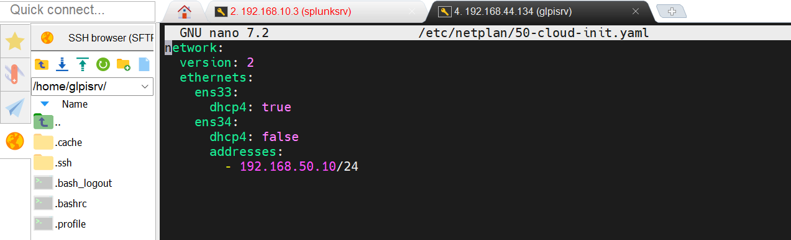
*Configuration réseau (netplan)*


*Adresses IP de glpi-srv*

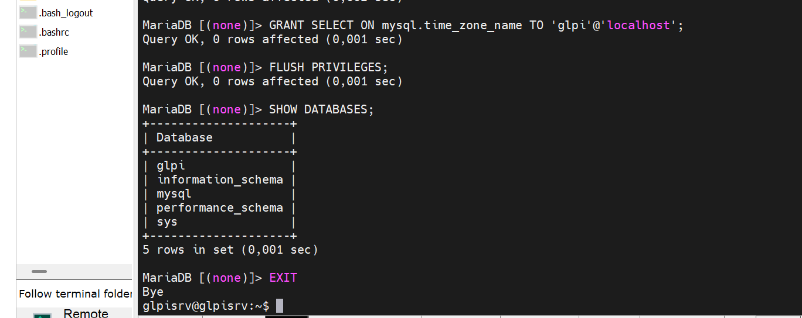
*Base MariaDB*

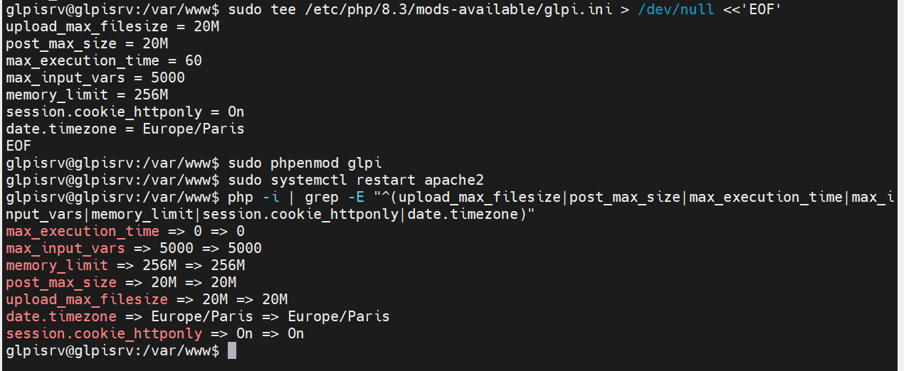
*Configuration PHP*

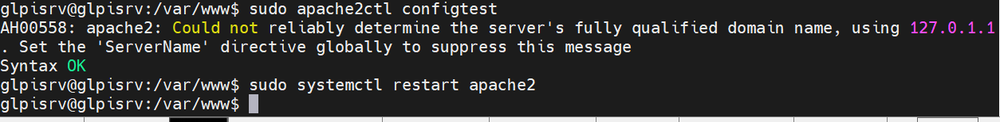
*apache2ctl configtest : Syntax OK*

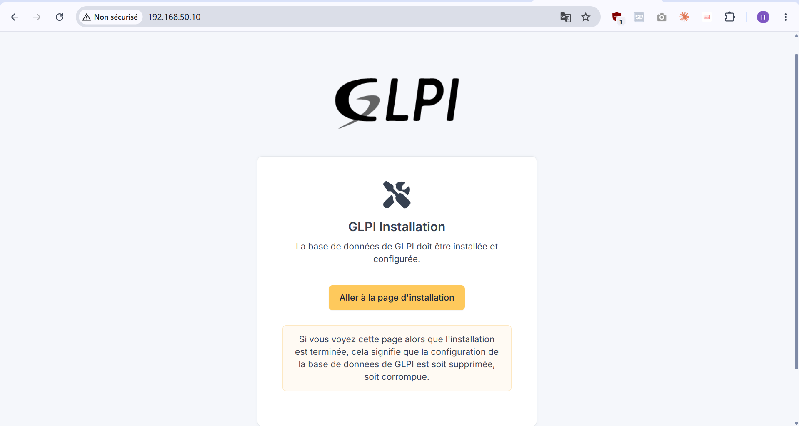
*Assistant d'installation de GLPI*

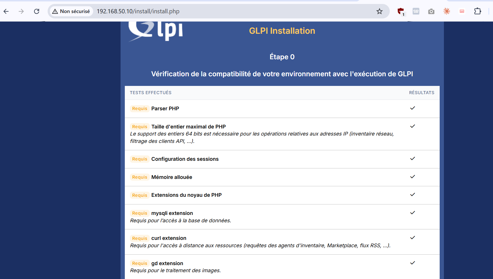
*Prérequis (1/3)*

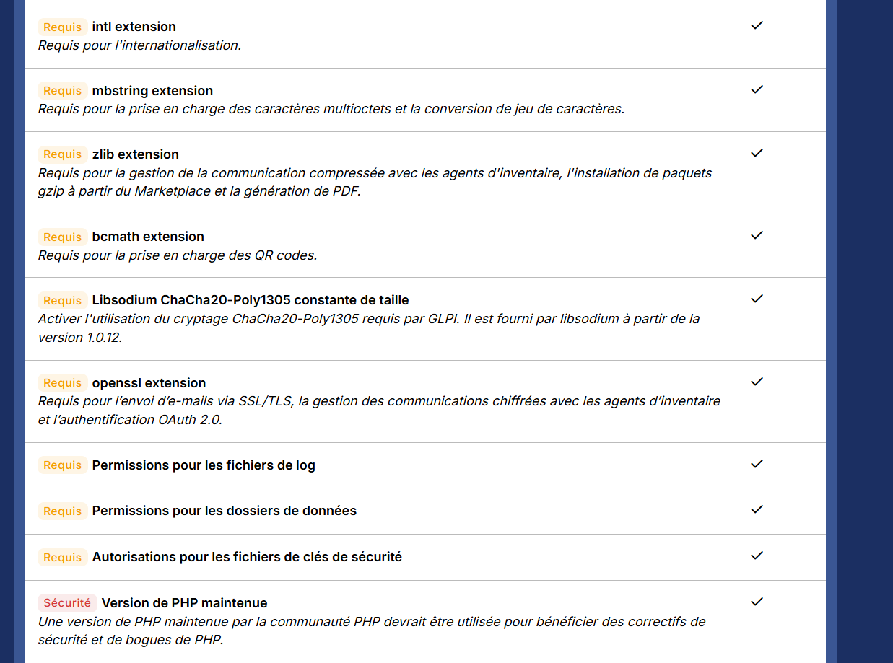
*Prérequis (2/3)*


*Prérequis (3/3)*

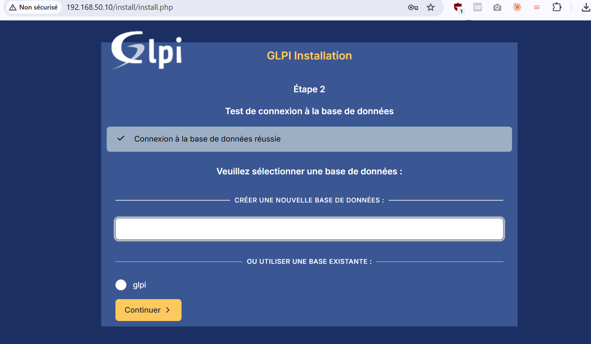
*Connexion à la base*

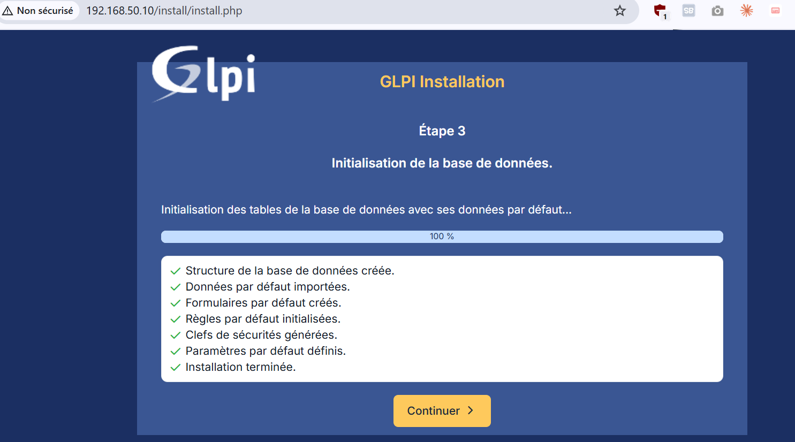
*Installation terminée*

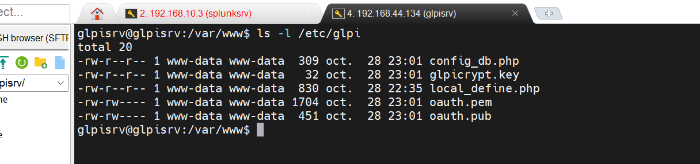
*Fichiers de configuration*

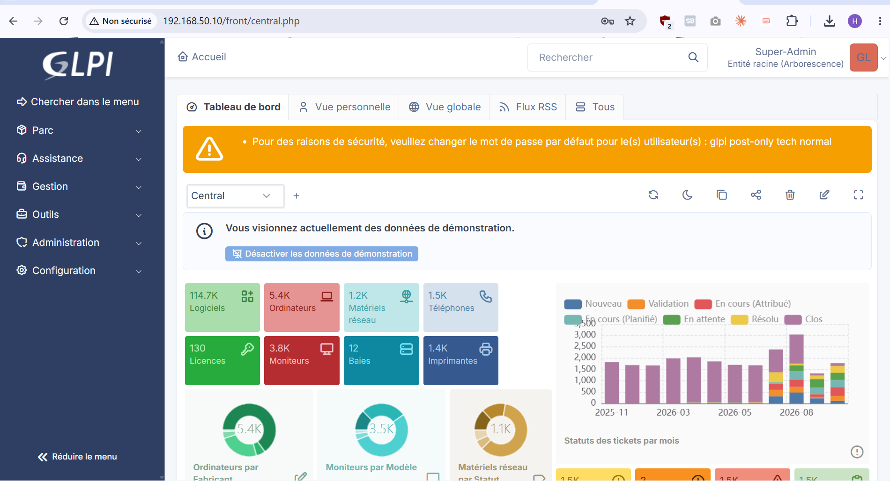
*Avertissements de sécurité (avant)*

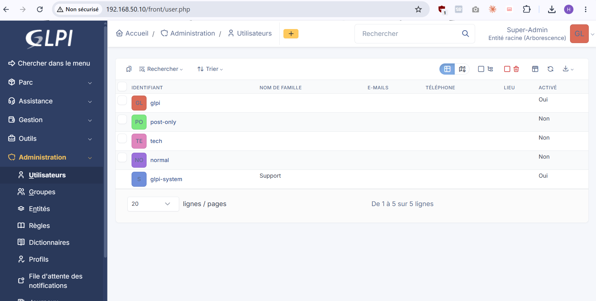
*Comptes sécurisés*

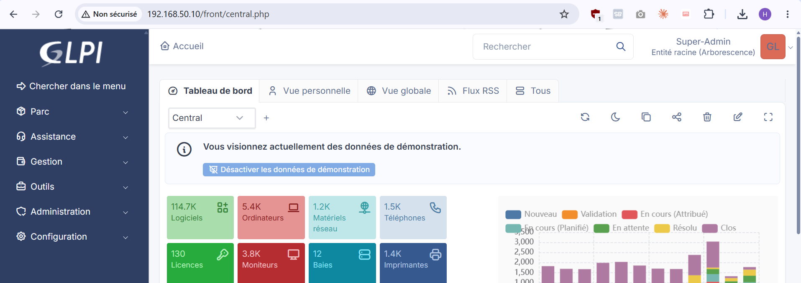
*Bandeau disparu (après)*

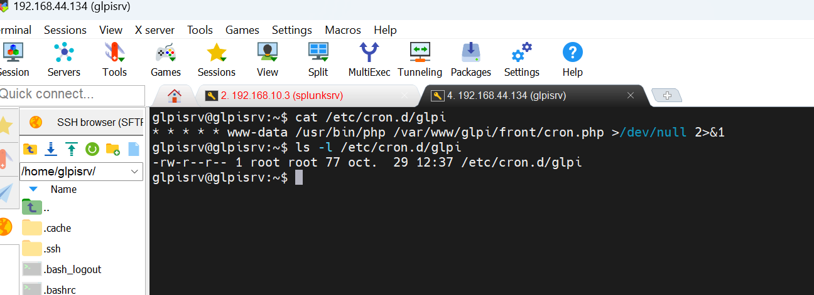
*Tâches planifiées de GLPI*

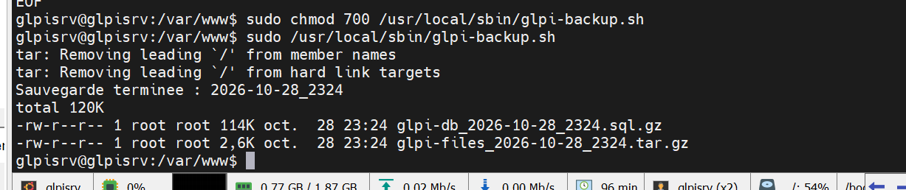
*Exécution du script de sauvegarde*

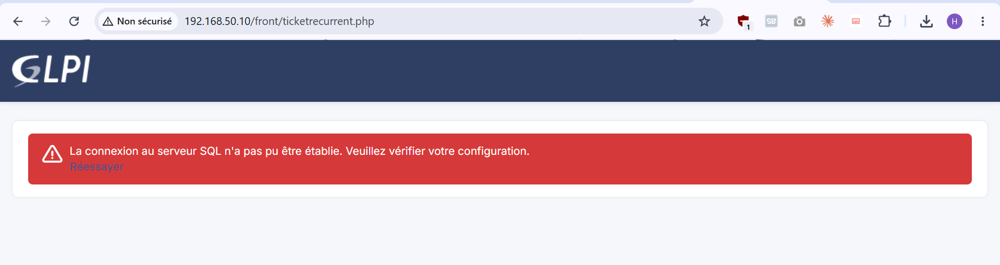
*Base détruite (avant restauration)*

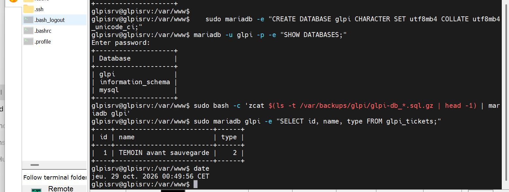
*Restauration*

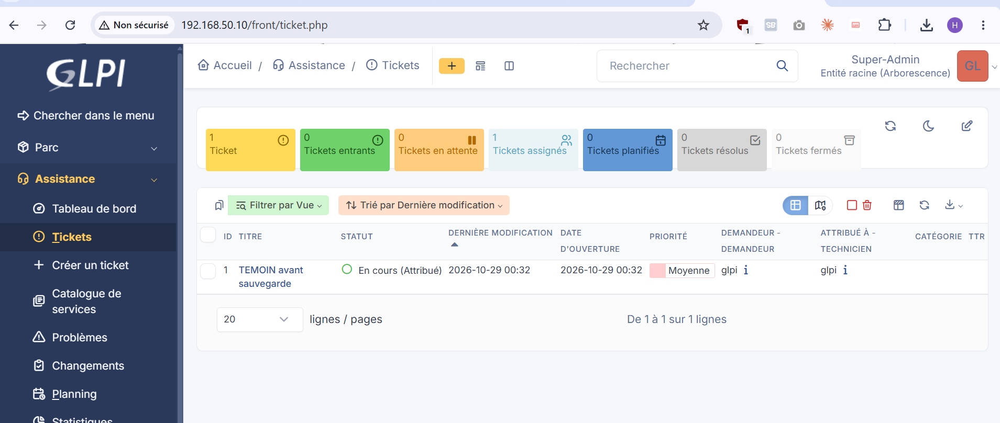
*Restauration réussie : ticket témoin retrouvé*
