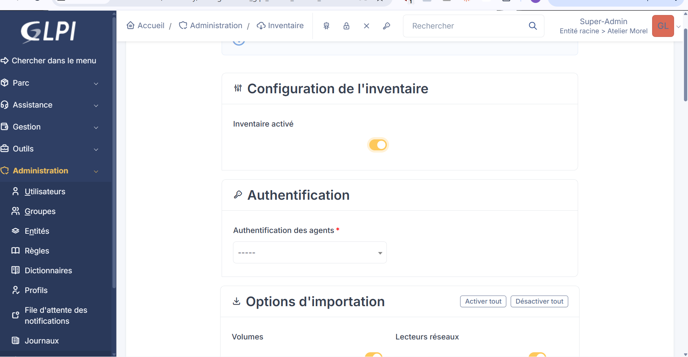
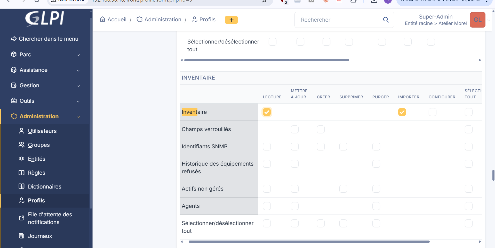
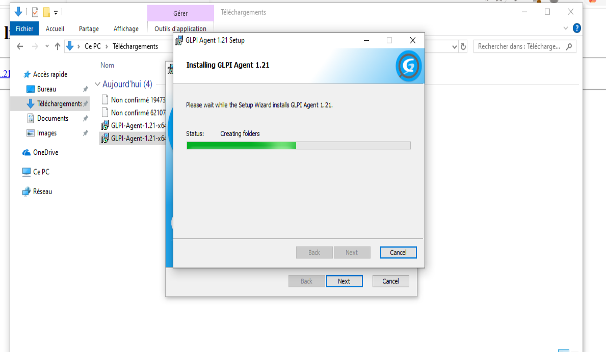
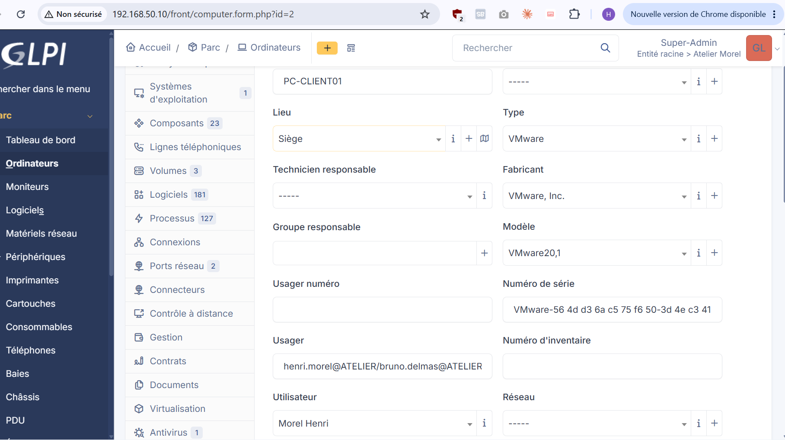
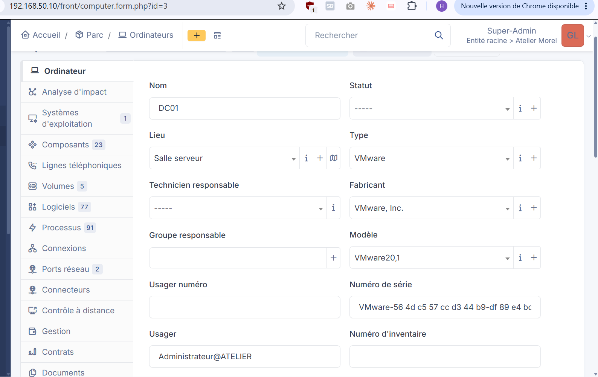

# Inventaire du parc avec GLPI Agent

## Principe

Un **agent** installé sur chaque machine collecte le matériel, le système et les logiciels, puis les envoie en HTTP à GLPI
(`http://glpi.atelier.local/front/inventory.php`). GLPI crée ou met à jour la fiche de la machine.

## Côté GLPI

1. Administration > Inventaire : **Inventaire activé**.
2. **Authentification des agents** : *Authentification basique* (GLPI 12 impose un choix : *Aucun* est déconseillé, *OAuth* est plus lourd).
3. Compte dédié `svc-agent-glpi` avec le profil **Agent inventaire** (droits d'inventaire uniquement) sur l'entité Atelier Morel.
4. Règle d'affectation à l'entité : **Tag = `Atelier-Morel` → Entité Atelier Morel** (voir [INC-04](../incidents/INC-04-poste-mauvaise-entite.md)).

## Côté poste (installation en ligne de commande)

```powershell
$mdp   = Read-Host -AsSecureString "Mot de passe svc-agent-glpi"
$clair = [System.Net.NetworkCredential]::new("", $mdp).Password
$params = @(
  "/i", "$env:USERPROFILE\Downloads\GLPI-Agent-1.21-x64.msi", "/qn",
  "SERVER=http://glpi.atelier.local/front/inventory.php",
  "USER=svc-agent-glpi", "PASSWORD=$clair",
  "TAG=Atelier-Morel", "ADD_FIREWALL_EXCEPTION=1", "RUNNOW=1"
)
Start-Process msiexec.exe -ArgumentList $params -Wait
Remove-Variable clair, mdp, params
& "C:\Program Files\GLPI-Agent\glpi-agent.bat" --force --full
```

| Élément | Rôle |
|---|---|
| `/i <msi>` | installer ce paquet |
| `/qn` | installation silencieuse, aucune fenêtre |
| `SERVER` | URL où l'agent envoie ses rapports |
| `USER`, `PASSWORD` | identifiants de l'authentification basique |
| `TAG` | étiquette envoyée avec chaque inventaire (sert au routage vers l'entité) |
| `ADD_FIREWALL_EXCEPTION=1` | ouvre le port de l'agent dans le pare-feu Windows |
| `RUNNOW=1` | lance un inventaire à la fin de l'installation |
| `Start-Process ... -Wait` | attend la fin de l'installeur avant de continuer |
| `--force` | envoie l'inventaire même si le serveur ne le demande pas |
| `--full` | inventaire **complet** (sinon l'agent peut envoyer un inventaire partiel, voir [INC-05](../incidents/INC-05-inventaire-partiel.md)) |

`$args` est une variable réservée de PowerShell : ne pas l'utiliser pour la liste d'arguments (la variable resterait vide).

Si l'installation graphique rapide a déjà été faite, les identifiants peuvent être posés dans le registre :

```powershell
$cle = "HKLM:\SOFTWARE\GLPI-Agent"
Set-ItemProperty -Path $cle -Name "user"     -Value "svc-agent-glpi"
Set-ItemProperty -Path $cle -Name "password" -Value $clair
Set-ItemProperty -Path $cle -Name "tag"      -Value "Atelier-Morel"
Restart-Service -Name "GLPI-Agent"
```

## Vérifier

```powershell
Get-Service -Name "GLPI-Agent"
Get-Content "C:\Program Files\GLPI-Agent\logs\glpi-agent.log" -Tail 15
```

Puis dans GLPI : Parc > Ordinateurs. La fiche contient le système, les composants, les logiciels, les volumes et l'antivirus.

## Rattachement aux utilisateurs

L'agent remonte aussi les comptes connectés sur le poste. GLPI rattache alors l'ordinateur à l'utilisateur de même identifiant
(les comptes importés de l'AD portent le même `prenom.nom` que les comptes Windows). Limite : sur un poste partagé, un seul utilisateur est retenu.

## Passer à l'échelle (100 postes et plus)

L'installation à la main ne se fait pas à cette échelle. En domaine Active Directory :
- déposer le MSI sur un partage en lecture seule ;
- déployer par **GPO** (script de démarrage qui installe l'agent s'il est absent, avec les mêmes paramètres) sur l'OU `Ordinateurs` ;
- le tag route automatiquement les postes vers la bonne entité.

## Limites connues

- Authentification basique : le mot de passe du compte `svc-agent-glpi` est stocké sur le poste (clé de registre de l'agent). Atténué par un compte
  à moindre privilège ; en production, préférer **OAuth**.
- Pas de HTTPS sur GLPI dans ce lab (piste d'amélioration).

## Captures


*Inventaire activé dans GLPI*


*Profil « Agent inventaire » : seul le droit Inventaire (Lecture, Importer)*


*Installation de GLPI Agent 1.21*


*Service GLPI-Agent en fonctionnement*


*Fiche du poste : composants, logiciels, utilisateur et lieu rattachés automatiquement*


*Fiche de DC01 (serveur) : lieu Salle serveur*
