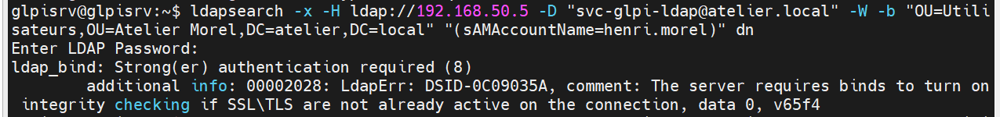
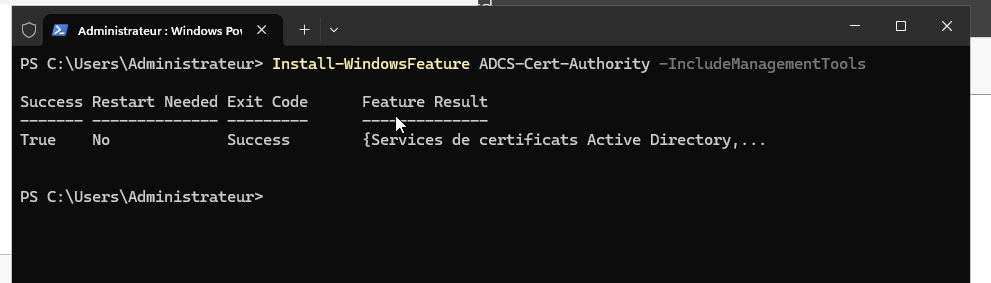
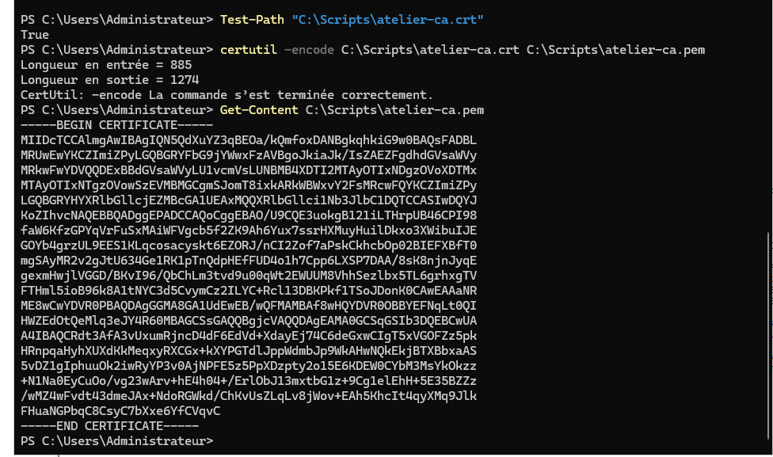
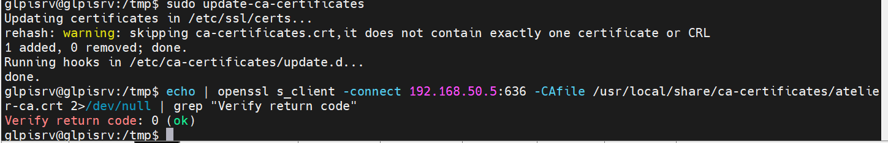
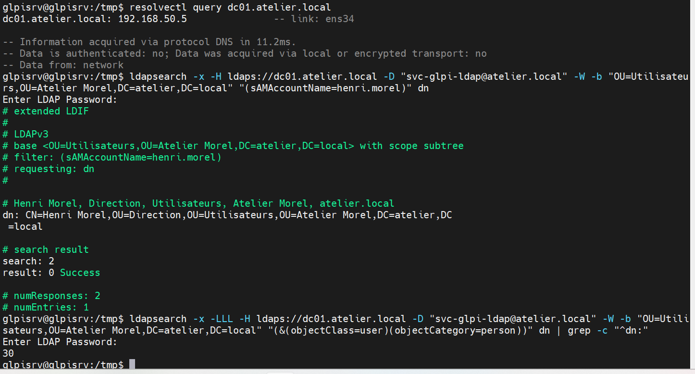
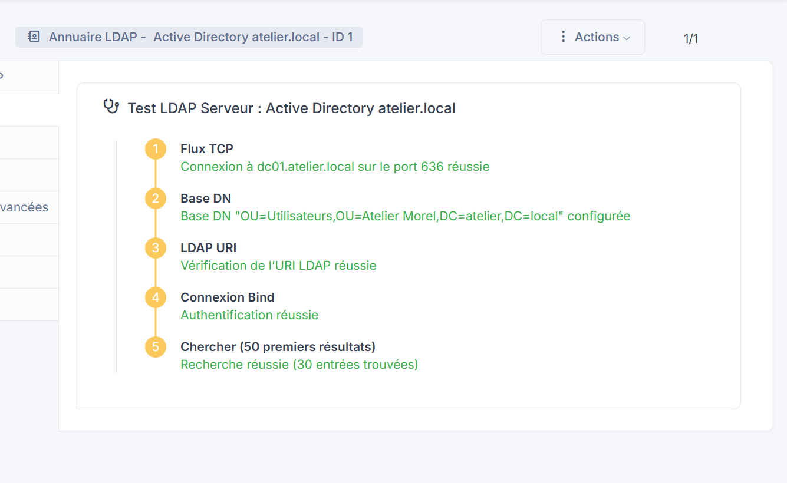

# INC-01 : liaison LDAP refusée (« Strong(er) authentication required »)

| | |
|---|---|
| Catégorie | Compte / Authentification |
| Composants | glpi-srv (GLPI 12), DC01 (Windows Server 2025, AD DS) |
| Impact | Impossible d'importer les utilisateurs AD dans GLPI |
| Priorité | Haute |

## Symptômes
- Dans GLPI (Configuration > Authentification > Annuaires LDAP), le bouton **Tester** affiche « Test échoué ».
- Depuis glpi-srv, une recherche LDAP simple sur le port 389 renvoie `ldap_bind: Strong(er) authentication required (8)`.

## Diagnostic
1. Le DNS et le réseau sont bons (ping et résolution de `atelier.local` OK) : le problème ne vient pas de la connectivité.
2. Test direct, hors GLPI, pour isoler la cause :
   ```bash
   ldapsearch -x -H ldap://dc01.atelier.local -D "svc-glpi-ldap@atelier.local" -W \
     -b "OU=Atelier Morel,DC=atelier,DC=local" -LLL
   ```
   - `-x` : authentification simple (pas SASL)
   - `-H <URI>` : serveur à contacter
   - `-D <DN>` : compte utilisé pour se connecter (le compte de service)
   - `-W` : demande le mot de passe à l'invite (rien dans l'historique)
   - `-b <base>` : point de départ de la recherche dans l'annuaire
   - `-LLL` : sortie compacte (LDIF sans commentaires)
3. L'erreur 8 prouve que le contrôleur de domaine **refuse les liaisons simples en clair** : Windows Server 2025 impose la signature LDAP / l'authentification renforcée.

## Cause racine
Le contrôleur de domaine exige un canal chiffré ou signé. GLPI se connectait en LDAP clair (port 389) avec un bind simple, ce que le DC rejette.

## Correction
1. Sur DC01 : déployer **AD CS** (autorité de certification racine d'entreprise « Atelier-Morel-CA »). Le DC reçoit ainsi un certificat et écoute en **LDAPS (636)**.
2. Exporter le certificat de l'autorité en PEM :
   ```powershell
   $ca = Get-ChildItem Cert:\LocalMachine\Root | Where-Object {$_.Subject -like "*Atelier-Morel-CA*"} |
         Sort-Object NotBefore -Descending | Select-Object -First 1
   Export-Certificate -Cert $ca -FilePath C:\Scripts\atelier-ca.crt -Type CERT
   certutil -encode C:\Scripts\atelier-ca.crt C:\Scripts\atelier-ca.pem
   ```
3. Sur glpi-srv : faire confiance à l'autorité, puis tester la chaîne TLS :
   ```bash
   sudo cp atelier-ca.crt /usr/local/share/ca-certificates/atelier-ca.crt
   sudo update-ca-certificates
   openssl s_client -connect dc01.atelier.local:636 -CAfile /usr/local/share/ca-certificates/atelier-ca.crt </dev/null
   ```
   - `update-ca-certificates` : ajoute l'autorité au magasin de confiance du système
   - `openssl s_client -connect` : ouvre une connexion TLS et affiche le certificat
   - `-CAfile` : autorité servant à valider (on attend `Verify return code: 0 (ok)`)
4. Reprendre `ldapsearch` en `ldaps://` (même commande, `-H ldaps://dc01.atelier.local`), puis dans GLPI : port **636**, connexion sécurisée activée.

## Vérification
`Test réussi` dans GLPI, puis import des 30 utilisateurs depuis l'annuaire.

## Prévention
- Utiliser LDAPS dès la conception, ne jamais baisser la sécurité du DC pour « faire marcher ».
- Compte de service à moindre privilège (`svc-glpi-ldap`, lecture seule, mot de passe en gestionnaire).
- Documenter l'autorité de certification et sa date d'expiration.

## Captures


*Erreur « Strong(er) authentication required (8) » sur ldap:// (port 389)*


*Installation du rôle AD CS*


*Export du certificat de l'autorité*


*Autorité approuvée sur glpi-srv*


*ldapsearch en LDAPS : réponse correcte (30 utilisateurs)*


*Test LDAP réussi dans GLPI (port 636)*
